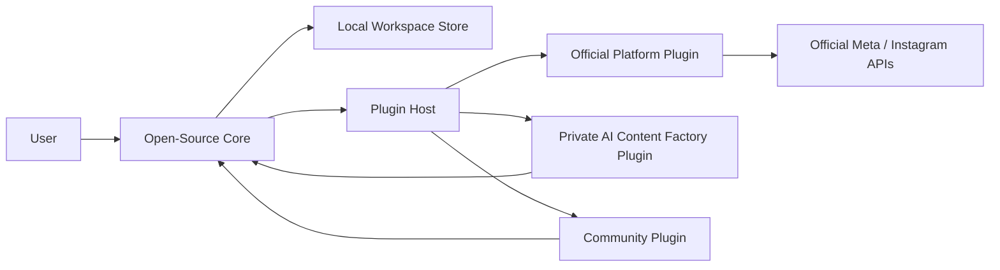
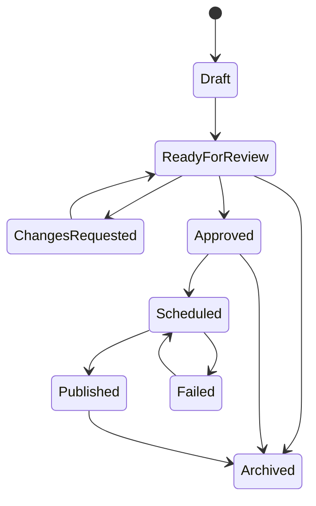

# IG Manager Architecture Overview

## Architecture Goals

IG Manager should be built as a local-first, extensible content operations platform. The architecture must support multiple Instagram accounts, multiple concepts per account, structured assets and references, post candidates, review workflow, scheduling, official publishing plugins, community plugins, and private AI content factory plugins.

The architecture should make these boundaries clear:

- Open-source Core owns local data, domain models, workflow policy, UI, scheduling state, and plugin contracts.
- Official platform plugins own authentication, capability discovery, validation, publishing, and analytics through official APIs.
- Community plugins extend workflows through declared permissions and capabilities.
- Private AI plugins create or enrich content candidates but remain separate from the Core and do not bypass review by default.

## Non-Negotiable Constraints

- Use official APIs only for publishing, account access, media upload, and analytics.
- Do not implement scraping.
- Do not implement stealth browser automation.
- Do not implement CAPTCHA bypass.
- Do not implement anti-detection behavior.
- Do not implement engagement bots for likes, comments, follows, unfollows, or direct messages.
- Do not make uncontrolled auto-publishing the default.

## System Context



## Core Responsibilities

### Workspace Management

- Initialize local workspaces.
- Store workspace settings.
- Manage local persistence and migrations.
- Support export and backup.
- Keep secrets separate from ordinary project data.

### Domain Model

- Accounts.
- Concepts.
- Concept profiles.
- Assets.
- References.
- Post candidates.
- Review decisions.
- Schedule entries.
- Publish records.
- Plugin registrations.
- Audit events.

### Workflow Policy

- Define allowed state transitions.
- Enforce review-before-publish defaults.
- Record approvals and change requests.
- Validate scheduling prerequisites.
- Prevent plugins from silently bypassing workflow policy.

### User Interface

- Account and concept management.
- Asset and reference library.
- Candidate editor.
- Review queue.
- Schedule calendar.
- Plugin manager.
- Publish status and error views.

### Plugin Contracts

- Manifest schema.
- Capability schema.
- Permission model.
- Validation hooks.
- Candidate creation hooks.
- Schedule hooks.
- Publish hooks.
- Analytics ingestion hooks.
- Audit logging hooks.

## Proposed Domain Entities

### Workspace

Represents the local project boundary.

Key fields:

- `id`
- `name`
- `createdAt`
- `updatedAt`
- `settings`
- `schemaVersion`

### Account

Represents an Instagram account managed in the workspace.

Key fields:

- `id`
- `platform`
- `handle`
- `displayName`
- `timezone`
- `status`
- `defaultReviewPolicy`
- `pluginConnectionIds`
- `notes`

### Concept

Represents a reusable creative and operational profile under an account.

Key fields:

- `id`
- `accountId`
- `name`
- `description`
- `audience`
- `contentPillars`
- `tone`
- `visualStyle`
- `captionRules`
- `hashtagGuidance`
- `constraints`
- `cadenceGoal`
- `referenceIds`
- `assetIds`
- `reviewPolicy`

### Asset

Represents owned or usable media and supporting files.

Key fields:

- `id`
- `type`
- `path`
- `title`
- `tags`
- `source`
- `rights`
- `linkedAccountIds`
- `linkedConceptIds`
- `createdAt`

### Reference

Represents inspiration, research, or external examples. References are not automatically owned assets.

Key fields:

- `id`
- `type`
- `url`
- `title`
- `notes`
- `source`
- `linkedAccountIds`
- `linkedConceptIds`
- `capturedAt`

### PostCandidate

Represents a draft content unit that may become a scheduled or published post.

Key fields:

- `id`
- `accountId`
- `conceptId`
- `format`
- `mediaAssetIds`
- `captionVersions`
- `selectedCaptionId`
- `hashtags`
- `altTextNotes`
- `internalNotes`
- `referenceIds`
- `status`
- `provenance`
- `validationWarnings`
- `createdBy`
- `createdAt`
- `updatedAt`

### ReviewDecision

Represents a review action.

Key fields:

- `id`
- `candidateId`
- `decision`
- `reviewer`
- `notes`
- `createdAt`

### ScheduleEntry

Represents planned publication.

Key fields:

- `id`
- `candidateId`
- `accountId`
- `scheduledAt`
- `timezone`
- `status`
- `validationResult`
- `createdAt`

### PublishRecord

Represents a publish attempt or completed publication.

Key fields:

- `id`
- `candidateId`
- `pluginId`
- `platformPostId`
- `status`
- `attemptedAt`
- `publishedAt`
- `errors`
- `warnings`
- `rawResultRef`

### PluginRegistration

Represents an installed plugin.

Key fields:

- `id`
- `name`
- `version`
- `manifest`
- `capabilities`
- `permissions`
- `enabled`
- `settingsRef`

## Candidate State Model



## Plugin Architecture

### Plugin Host

The Plugin Host mediates all plugin access to Core data and workflow actions. Plugins should not directly mutate the workspace store. Instead, they should call Core APIs that enforce permissions, state transitions, validation, and audit logging.

### Plugin Manifest

Each plugin should declare:

- Plugin ID.
- Name and version.
- Author.
- Capability list.
- Requested permissions.
- Supported platforms.
- Required configuration.
- Data access requirements.
- Official API usage declaration for publishing plugins.

### Capability Types

- `candidate.generator`
- `candidate.enricher`
- `asset.processor`
- `reference.importer`
- `schedule.validator`
- `publisher.official`
- `analytics.reader`
- `exporter`
- `workflow.extension`

### Permission Types

- Read accounts.
- Read concepts.
- Read assets.
- Read references.
- Read candidates.
- Write candidates.
- Update candidate status.
- Read schedule.
- Write schedule.
- Publish approved scheduled candidates.
- Read analytics.
- Store plugin settings.

### Official Publishing Plugin Contract

Publishing plugins must:

- Use official APIs only.
- Authenticate through supported platform flows.
- Declare supported account types and media formats.
- Report capability limitations.
- Validate candidates before scheduling and before publishing.
- Return structured errors.
- Respect Core review policy.
- Record publish results.

Publishing plugins must not:

- Scrape platform pages.
- Control browsers to simulate human publishing.
- Bypass CAPTCHA or platform challenges.
- Include anti-detection logic.
- Automate engagement actions.

### Private AI Plugin Contract

Private AI plugins may:

- Read permitted concept profiles, assets, references, and prior candidates.
- Generate candidate drafts.
- Suggest captions, variants, hashtags, hooks, and schedule slots.
- Attach provenance.
- Mark candidates as draft or ready for review if policy allows.

Private AI plugins must not:

- Publish directly.
- Bypass review policy.
- Store private generation logic in the open-source Core.
- Scrape unauthorized content.
- Hide generation provenance from reviewers.

## Local Storage Strategy

The first implementation should favor simple, inspectable local storage. Suitable options include:

- SQLite for structured records.
- Filesystem directories for media assets and large files.
- JSON or YAML export for portable backups.
- OS credential store or encrypted local secret store for tokens.

### Suggested Workspace Layout

```text
workspace/
  ig-manager.db
  assets/
  exports/
  plugins/
  backups/
  logs/
```

Secrets should not be committed to version control or included in ordinary exports.

## Scheduling Architecture

Scheduling should be separated from publishing:

- Schedule entries can exist without a connected publishing plugin.
- Publishing requires an official platform plugin.
- Final validation should happen before publishing.
- Retry behavior should be explicit, bounded, and aware of official API errors.
- The scheduler should never silently publish unapproved candidates.

## Validation Layers

### Core Validation

- Required account and concept fields.
- Candidate status requirements.
- Review approval requirements.
- Schedule time and timezone.
- Asset existence.
- Basic caption and media completeness.

### Plugin Validation

- Official API permissions.
- Token status.
- Account type support.
- Media format support.
- Caption length and media limits.
- Rate limits or publish window constraints where exposed by official APIs.

## Audit And Provenance

The Core should record:

- Candidate creation source.
- Plugin-generated content provenance.
- Review decisions.
- Schedule changes.
- Publish attempts.
- Plugin actions that modify workspace data.
- Validation failures.

This supports accountability, debugging, and review quality.

## Security And Privacy

- Keep user data local by default.
- Store tokens securely outside ordinary workspace files.
- Require explicit plugin permissions.
- Show users what each plugin can read and write.
- Avoid sending local data to external services unless a plugin clearly requests permission.
- Keep private AI plugin data handling separate from Core.

## Extensibility Boundaries

### Stable Core APIs

Core APIs should cover:

- Query accounts, concepts, assets, references, and candidates.
- Create and update post candidates through policy-aware methods.
- Submit review decisions.
- Create schedule entries.
- Request validation.
- Invoke publish action for approved scheduled candidates.
- Record plugin results.

### Versioning

- Workspace schema should be versioned.
- Plugin manifest schema should be versioned.
- Capability contracts should be versioned.
- Breaking changes should require migrations.

## MVP Architecture Phases

### Phase 1: Local Core

- Local workspace.
- Domain models.
- Basic persistence.
- Account and concept UI.
- Asset and reference library.
- Manual post candidate creation.

### Phase 2: Workflow And Scheduling

- Review state machine.
- Review queue.
- Approval history.
- Schedule entries.
- Calendar view.
- Export.

### Phase 3: Plugin Foundation

- Plugin manifest.
- Capability registry.
- Permission model.
- Plugin manager UI.
- Validation hooks.

### Phase 4: Official Publishing

- Official Instagram connector.
- Authentication.
- Capability discovery.
- Publish validation.
- Publish action.
- Publish records.

### Phase 5: Automation Extensions

- Private AI content factory plugin interface.
- Candidate generation hooks.
- Provenance model.
- Analytics plugin interface.

## Open Architecture Questions

- Should the first desktop implementation use Electron, Tauri, or a web app with local backend?
- Should local storage start with SQLite immediately or begin with file-based JSON and migrate later?
- How should plugin isolation be implemented in the first version?
- Which official Instagram API capabilities are available for the target account types?
- Should collaboration be local-only, self-hosted, or deferred entirely?
- What is the minimum permission model needed for MVP plugins?

