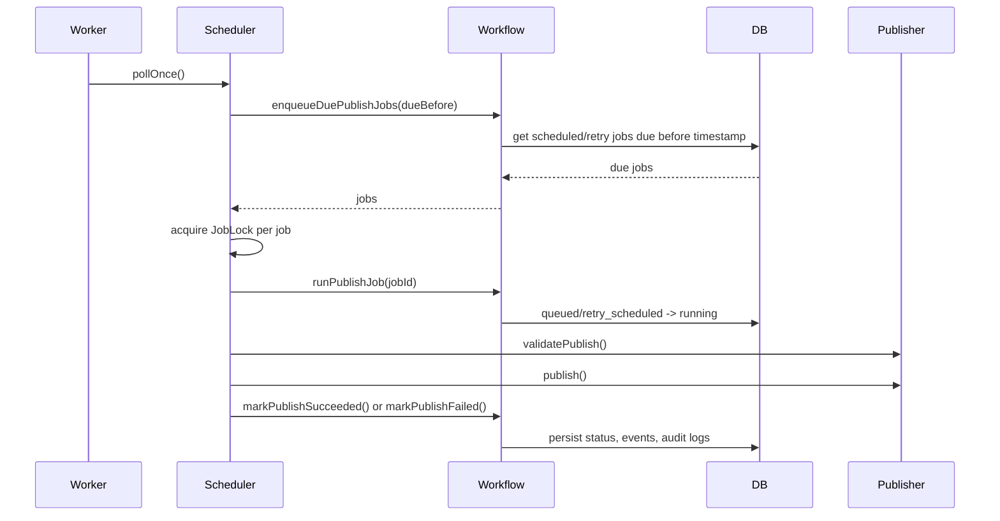

# Local Scheduler

The local scheduler runs on a user's computer and polls the local SQLite workspace for due publish jobs. It is intentionally small for MVP: no Redis, no hosted queue, and no platform-specific behavior.

## Responsibilities

- Poll due publish jobs on a configurable interval.
- Skip jobs that are already locked in the current worker process.
- Start jobs through the workflow engine.
- Execute a publisher plugin contract.
- Mark success or failure through the workflow engine.
- Apply bounded retry timing for retryable failures.
- Support dry-run mode that does not call the publisher.
- Print clear structured logs.

## Package Boundaries

`packages/scheduler-core` contains reusable scheduling primitives:

- `Clock` and `SystemClock`
- `JobPoller`
- `JobLock` and `InMemoryJobLock`
- `RetryPolicy` and `FixedIntervalRetryPolicy`
- `SchedulerService`
- `createMockPublisherPlugin`

`apps/worker` wires those primitives to the local runtime:

- reads environment config
- opens SQLite
- runs migrations
- creates DB repositories
- creates the workflow engine
- records workflow events into SQLite
- installs the mock publisher registry
- handles `SIGINT` and `SIGTERM`

The scheduler core depends on workflow and plugin contracts, not on the DB package. The worker app is the composition layer that binds scheduler-core to SQLite.

## Polling Flow

## Job State

SQLite remains the source of truth for job state:

- `queued`: scheduled and waiting for its due time
- `running`: actively executing
- `retry_scheduled`: failed with retry budget remaining
- `succeeded`: published successfully
- `failed`: terminal failure
- `canceled`: explicitly stopped before execution

The MVP `JobLock` prevents duplicate execution inside one local worker process. The persisted state transition to `running` is still performed by the workflow engine before publisher execution. If multi-process local workers become a requirement, the `JobLock` interface can be backed by a SQLite compare-and-swap lock without changing scheduler callers.

## Auto-Publish Guardrails

The worker defaults to `WORKER_TRIGGER=auto`. In auto mode, the workflow engine only returns and starts jobs that were explicitly scheduled with auto-publish metadata and are allowed by account/concept automation policy. Manual jobs can still be run by using `WORKER_TRIGGER=manual`, but this is an explicit operator choice.

Dry-run mode is controlled by `WORKER_DRY_RUN=true`. In dry-run mode, due jobs are selected and logged, but the scheduler does not call `runPublishJob`, does not invoke a publisher, and does not mutate publish job state.

## Retry Policy

`FixedIntervalRetryPolicy` returns the next `retryAfter` timestamp only when:

- the publisher reports a retryable failure
- the job has attempts remaining
- the scheduler retry policy allows another attempt

The workflow engine persists retry state using `retry_scheduled`. Jobs become terminal `failed` once attempts are exhausted or the error is not retryable.

## Worker Configuration

Environment variables:

- `WORKER_DATABASE_URL`: SQLite file path or `:memory:`. Defaults to `./data/ig-manager.sqlite`.
- `WORKER_POLL_INTERVAL_MS`: poll interval. Defaults to `30000`.
- `WORKER_DRY_RUN`: boolean. Defaults to `false`.
- `WORKER_RUN_ONCE`: boolean for one-shot execution. Defaults to `false`.
- `WORKER_LOG_LEVEL`: `debug`, `info`, `warn`, or `error`. Defaults to `info`.
- `WORKER_TRIGGER`: `auto` or `manual`. Defaults to `auto`.
- `WORKER_ACTOR_ID`: audit actor ID. Defaults to `local-worker`.
- `WORKER_WORKSPACE_ID`: plugin context workspace ID. Defaults to `local`.
- `WORKER_RETRY_MAX_ATTEMPTS`: scheduler retry ceiling. Defaults to `3`.
- `WORKER_RETRY_INTERVAL_MS`: fixed retry delay. Defaults to `300000`.

## Mock Publisher Path

Until real official publisher plugins are loaded, the worker binds enabled publisher plugin registrations to `createMockPublisherPlugin`. This gives the scheduler a real publisher contract path for local testing without adding Instagram-specific behavior or unofficial automation.

The mock publisher is a development stand-in only. Official platform publishers must still be implemented as plugins that use official APIs and declare permissions through the plugin SDK.
