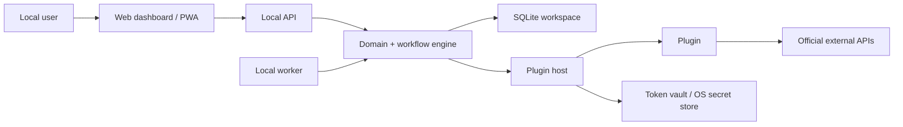

# Security Architecture

IG Manager is a local-first content operations platform. The security model assumes a user's workspace contains private account metadata, concept strategy, media assets, generated candidates, publish history, plugin settings, and audit logs.

## Goals

- Keep user data local by default.
- Keep Core platform-neutral and review-first.
- Use official APIs only for publishing and platform integrations.
- Prevent plugins from receiving broad implicit access.
- Keep secrets out of git, normal workspace exports, logs, and public query results.
- Make publish actions auditable.
- Keep auto-publish opt-in only.
- Keep private automation plugins separate from the open-source Core.

## Non-Goals

IG Manager will not implement:

- scraping,
- stealth browser automation,
- UI-based posting,
- CAPTCHA bypass,
- anti-detection behavior,
- credential sharing,
- engagement bots,
- uncontrolled auto-publishing.

## Trust Boundaries

The Core should own state transitions, audit logging, scheduling rules, and publish policy. Plugins should receive narrow request objects and host-provided services rather than raw database handles or unrestricted filesystem access.

## Local API

The API is local-first and intended for trusted local clients on the user's computer or local network.

MVP controls:

- optional bearer token through `IG_MANAGER_LOCAL_TOKEN`,
- public `GET /health` and API docs,
- request validation with Zod,
- typed response envelopes,
- sanitized plugin metadata in public responses.

Remaining hardening work:

- local-only default binding option for non-mobile use,
- CORS policy for explicit local origins,
- rate limiting for local network exposure,
- stricter token setup flow,
- CSRF review if browser clients use stored credentials.

## Secrets

Secrets must not be stored in manifests, normal database query results, generated docs, screenshots, or git.

Secret-like values include:

- access tokens,
- refresh tokens,
- cookies,
- OAuth client secrets,
- API keys,
- token vault files,
- private credential exports.

The preferred direction is an OS credential store or encrypted local token vault that is referenced by opaque ids. Public objects may include `settingsRef` or `secretRef`, but not raw secret values.

## Plugin Security

Every plugin must declare:

- manifest schema version,
- plugin type,
- distribution,
- permissions,
- capabilities,
- dry-run support,
- official API-only policy when it is a publisher.

The host must:

- validate manifests before enabling plugins,
- check permissions before invoking plugin operations,
- pass narrow request objects,
- enforce dry-run behavior,
- prevent direct database access,
- redact secrets from logs and results,
- write audit logs for workflow-changing plugin actions.

The SDK defines contracts; manifest validation alone does not make arbitrary plugin code safe. Any future plugin execution runtime needs sandboxing or process isolation appropriate to the risk level.

## Publishing Security

Publishing is gated by the workflow engine:

- generated candidates default to review,
- candidates must be approved before scheduling unless explicit policy allows auto-scheduling,
- auto-publish must be explicit per account or concept,
- publish jobs must use a publisher plugin,
- publisher plugins must use official APIs only,
- publish attempts must emit domain events and append audit logs,
- failed jobs have bounded retry behavior.

Publisher plugins must not contain scraping, browser automation, CAPTCHA bypass, anti-detection logic, or UI-based posting.

Once a publisher confirms success, a later local result, audit, or event failure
does not schedule another publish attempt. The scheduler reports the recording
failure and preserves the stored `running` or `succeeded` state. Check the
external post and reconcile local records before manually retrying; repeating
the external publish could create a duplicate post.

The Instagram publisher also preserves a confirmed post when its optional first
comment fails. It returns the post id with a warning, rather than a retryable
publish failure. Check the comment separately before adding it manually.

## Audit Logging

Audit logs should record:

- candidate creation,
- review decisions,
- schedule changes,
- publish job creation,
- publish attempts,
- publish success or failure,
- retry attempts,
- plugin enable or disable events,
- security-relevant configuration changes.

Audit records should include actor id, entity type, entity id, timestamp, action, and safe metadata. They should not include raw secrets.

## Private Automation Boundary

Private automation plugins may generate candidate drafts, prompts, captions, hashtags, and first comments. They must not be required for open-source Core startup or tests.

Private plugins must:

- remain outside Core packages,
- avoid committing provider secrets,
- mark outputs with provenance,
- default generated candidates to review,
- avoid republishing third-party images,
- treat external references as metadata or inspiration only,
- never bypass Core workflow policy.

## Data Handling

Local generated media and workspace databases may contain private information. `.gitignore` excludes local database files, token vaults, generated media, and private plugin secret paths. Contributors should still review staged files manually before sharing changes.

## Remaining Risks

- Plugin execution isolation is not complete.
- Secret storage is still at the architecture boundary rather than a hardened product feature.
- Local API exposure on `0.0.0.0` is useful for phones but increases local-network risk.
- Generated media provenance and deletion workflows need more product detail.
- Permission enforcement must be checked at every future plugin host boundary, not just in schemas.
